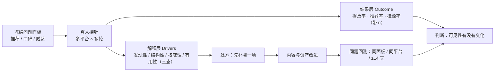

# 01｜GEO 指标模型：AI 答案里的"可见性"怎么量

> 系列：AI 应用笔记 · 01 ｜ 项目：源引 GEO（2026.07–2026.10，已阶段性中止）
> 面向：AI 应用 / Agent 产品经理面试官，以及要做"AI 品牌可见性"这类产品的同行
> 一句话：**不可解释的总分不是指标。** 可用的 GEO 度量只有两层——结果层回答"有没有被提到、被推荐、被引用"，解释层回答"哪些供给侧因素可能拖累结果"；两层不能互相替代，也不能加总成一个 0–100 分。

## 0. 先看结论

- **指标**：主 KPI 只保留结果层的三个率——提及率、推荐率、自有信源挂源率（下文统一叫"挂源率"），每个率都带样本量 n。
- **分层**：品牌词天然高分，不能当主 KPI；真正有生意的问法是"推荐类"（哪家好 / 怎么选 / 对比）和"场景类"（具体条件下怎么办）。早期按品牌词/行业词/场景词分层，后来改成按**问法意图**分层。
- **探针**：不依赖平台接口，用真人探针在真实 AI 产品里提问、留存原始回答与引用来源；规则打标为主、人工复核争议，不用 LLM 静默改主 KPI。
- **不能当 KPI**：复合总分、发文量/收录量、品牌词命中率、单次或单平台测量、仪器层的"引用布尔"、诊断四维——它们要么可刷，要么不可解释，要么天然虚高。
- **边界**：拿不到平台曝光/点击，只能从答案侧推断；小样本、单模型、无对照实验；项目已中止，6 个月复测目标没跑完。GEO 是概率问题，承诺"保证被引用"是骗人。

## 1. 问题：AI 答案里没有"曝光量"这个数

用户的行为正在从"搜网页"迁移到"问 AI"。当用户问一个 AI 助手"某个场景下有什么品牌推荐"，得到的不是链接列表，而是被生成、被压缩、被引用来源的答案。品牌的可见性不再只取决于排名，而取决于两件事：

1. AI 有没有**读到**你的信息（信源是否可达、内容是否可解析）；
2. AI 会不会在回答这个问题时**提到你、推荐你、引用你**。

这带来一个非常具体的度量难题：

- 平台不提供"你的品牌在答案里出现了几次"的后台数据；
- 不同平台答案随机、不可复现，也没有公开接口可以稳定拉取；
- SEO 时代的曝光/点击指标在这里失效——答案可能被直接读完，用户一次都不点链接。

所以我面对的第一性问题不是"怎么优化"，而是：**在固定的一批问题、固定的平台上，品牌被提到/被推荐/被引用的程度，能不能被稳定测量、被复现、被解释？**

这里要先分清两件事，后面整个模型都建立在这个区分上：

- **测量**回答"有没有"：这次答案里出现你了吗？是推荐还是中性提及？引用的是你的官网还是第三方转述？
- **诊断**回答"为什么"：如果没出现，是信源层缺失、信任层不足，还是采纳层被竞品压制？

两件事混在一起，就会出现"分数很低但不知道改什么"的产品。

## 2. 第一版口径：三个指标 + 按词性分层

### 2.1 三个指标

| 指标 | 定义 | 当时的计算方式 | 想回答的问题 |
|---|---|---|---|
| 可见率 | 品牌在 AI 答案中被提及的比例 | 命中提问数 ÷ 总提问数 | 最直观的"在不在场" |
| 推荐率 | 被提及时被正面推荐 / 列为可选方案的比例 | 正面推荐数 ÷ 提问数（或 ÷ 提及数，必须注明口径） | 区分"被知道"和"被推荐" |
| 自有信源引用率 | AI 引用的信源里，属于品牌自己的资产的比例 | 引用自有信源次数 ÷ 引用总次数 | 内容资产是否真的在起作用，是 GEO 与"发稿刷量"的分水岭 |

### 2.2 为什么要分层：品牌词 / 行业词 / 场景词

第一版的分层是按"词的属性"来的：

- **品牌词**：直接问品牌名（"某品牌怎么样、靠谱吗"）；
- **行业词**：问品类与服务（"这个行业找哪家好"）；
- **场景词/长尾问题句**：客户真实业务问题（"小规模纳税人能不能开专票"这类问法）。

分层不是为了报表好看，而是因为**这三类问题的难度完全不同，混在一起的总分没有意义**：

- 品牌词几乎必中：只要工商信息、官网、媒体报道里出现过，AI 回答"这个品牌怎么样"时很容易带出品牌名；
- 行业词才是生意：潜在客户在"选谁"的时候，AI 答案里有没有你，才决定有没有询盘；
- 场景词决定专业度：客户问的是具体问题，AI 引用谁的回答，谁就获得信任。

### 2.3 一次匿名诊断看到的结构

一次面向某本地服务企业的诊断（5 个 AI 平台、67 次提问：品牌词 19 次 + 行业词 48 次）呈现了非常典型的结构：

- **品牌词几乎全部命中（19/19）**：AI 知道有这个品牌，但来源几乎只有工商注册信息，说不出它能干什么；
- **行业词只命中约四分之一（12/48）**：潜在客户在真正的选购场景里看不到它；
- **平台盲区**：其中一个平台 36 次提问 0 次命中，同题下竞品被反复推荐。

结论不是"这个客户很差"，而是：**品牌词 100% 和行业词 25% 的落差，才是诊断的真正信息量。** 如果只报一个综合分，这个落差会被平均值藏起来——这也是后来我废掉综合分的直接原因之一。

### 2.4 这一版口径的三个坑

1. **推荐率的分母不一致**：除以"提问数"还是"提及数"，会得到两个完全不同的数。对外必须写清口径，否则同一份数据可以讲出两个故事。
2. **"自有"的边界不清**：官网算自有，公众号算不算？平台域（公众号文章链接所在域）不是品牌自己的域名；第三方媒体转载也不算。边界不写清，"自有信源引用率"就会虚高。
3. **品牌词几乎必中**：把它算进主 KPI，等于给自己送分。品牌词应该作为基准线，而不是成绩。

## 3. 决策 1：废掉 0–100 总分，改成"结果层 + 解释层"

**决策 1｜不做黑盒综合分，只做"结果层 + 解释层"**

- **背景**：早期我做了一个五维评估模型（可见、可信、结构化、价值、竞争力），把五维加权/乘积成一个 0–100 的"AI 可见度分"。给客户看第一眼很有效，但第二个问题必然出现——"这个分低，然后呢？" 我自己也解释不了某一维扣分对"被推荐"的因果影响；更糟的是，某客户的综合分很低，但品牌词其实是满分，分数掩盖了真正的分层问题。
- **取舍**：A. 继续用单分数——好卖、好对比、客户一眼懂；B. 拆成结果层 + 解释层——可解释、可行动，但对外叙事变复杂，客户一开始会觉得"没有分数不好懂"。
- **结论**：选 B。**对外只认结果层的率（必须带 n）；解释层四维只用来排"先做什么"，三态展示（通过 / 有缺口 / 尚未核查），不加总、不算乘积、不出现 0–100。** 没测到的项标"未评估"，不制造"没测 = 通过"。
- **代价**：早期销售叙事更费口舌；客户需要被教育"为什么没有总分"；内部要维护两套术语，且要抵抗"给我一个分数"的反复要求。换来的好处是——每一个数字都能回答"然后做什么"。

### 3.1 结果层：三个率 + 五档

后来定版的结果层只保留三个主 KPI，且**统计面被严格限定**：

| 指标 | 统计口径 | 一句话解释 |
|---|---|---|
| 提及率 | 仅"推荐类"问法；最终回答正文出现品牌（未提及 / 中性提及 / 备选 / 主推 / 不推荐五档） | 客户在"选谁"的问题里有没有看到你 |
| 推荐率 | 仅"推荐类"问法；主推或备选才计数，中性提及不算 | 你是被推荐，还是只是被提到 |
| 挂源率 | 有效回答中，至少出现一条"自有信源"URL 的比例 | AI 引用的是你的资产，还是别人的转述 |

两个容易做错的口径细节：

- **分母只取推荐类问法**。"点名问法"（"某品牌怎么样"）几乎必提及，不进两率；触达类问法（"官网在哪、怎么联系"）单独看信息是否正确，不和可见度混在一个率里。推荐类里主推/备选 ⊆ 提及，所以提及率 ≥ 推荐率是天然成立的，出现倒挂说明打标有问题。
- **挂源 ≠ 提及**。答案正文提到品牌名，不代表它引用了你的内容；引用面板里出现一条链接，也不代表正文采纳了它。所以"挂源率"的分子必须先做归属过滤：官网主域、绑定并认证过的品牌可控信源算自有；第三方媒体、百科、点评平台不算；平台域（如公众号文章所在域）不是品牌自有域。

### 3.2 解释层：四维三态，不加总

解释层保留四个可以被人为干预的供给侧维度：**发现性、结构性、权威性、有用性**。每个维度只输出三态（通过 / 有缺口 / 尚未核查），点开是具体的子项和证据，最多给 5 张"先做什么"的行动卡。

- 四维用来解释和排序，不叫"可见度分"，也不加总；
- 没有测量仪器的子项标"尚未核查"，不标"通过"，也不推给用户"去填资料"；
- 竞争性不做成"通过/缺口"的灯，因为提及率、推荐率本身已经是同一批问法上的结果，竞争性应该体现在"同题下竞品的出现情况"里。

## 4. 决策 2：从"按词性分层"到"按问法意图分层"

**决策 2｜用问法意图（推荐 / 口碑 / 触达）替代品牌词 / 行业词 / 场景词作为统计分层**

- **背景**：品牌词/行业词/场景词解决了"品牌词虚高"，但没有解决另一个问题：同一批"行业词"里，有的是"哪家好"（推荐类），有的是"这个品牌评价如何"（口碑类），有的是"怎么联系"（触达类）。把它们都塞进一个分母，数字还是不可解释；而且"点名问法"几乎必提及，会系统性拉高提及率。
- **取舍**：A. 继续按词性分层——客户容易懂，问题集设计简单；B. 按意图分层——更贴近用户决策路径，但要求问题集做成固定面板、分母分开统计，客户学习成本更高。
- **结论**：选 B。主 KPI 只取**推荐类**问法的提及率/推荐率；**口碑类**只做列表展示、不进率；**触达类**单独测"信息是否正确、官方入口是否可找到"。品牌词/行业词/场景词作为问题集设计时的取材来源保留，但不再作为统计分母。
- **代价**：问题面板必须版本化——一旦改动问题，就不能和旧数据直接对比，只能在同一 `panel_version` 内比较；客户需要理解"为什么我的品牌词不算分"；跨客户横向对比也变得更难（面板不同）。我认为这个代价值得：**不可解释的对比，不如不可对比。**

| 问法意图 | 典型问法 | 进主 KPI 吗 | 说明 |
|---|---|---|---|
| 推荐 | 哪家好 / 怎么选 / 对比 | 是（分母） | 生意发生的地方 |
| 口碑 | 某品牌怎么样 / 评价如何 | 否（仅展示五档） | 点名问法几乎必提及，防虚高 |
| 触达 | 官网在哪 / 怎么联系 | 否（单独测正确性） | 测的是"找到你"，不是"看到你" |

## 5. 方法：真人探针怎么做

### 5.1 为什么不用接口、不依赖后台

- 平台没有公开、稳定、与 C 端答案一致的接口；用接口模拟出来的答案和用户看到的不一样；
- 答案随机性大，必须多轮、多时间点复测；
- 只有人能判断"这句话是推荐、是中性提及、还是委婉否定"，纯关键词匹配会误判；
- 客户能亲眼看到提问过程，信任成本最低。这也决定了产品形态是"现场演示 + 实时实测"，而不是"交一份报告"。

合规边界也是产品的一部分：探针在用户本地的浏览器里完成，云端不保存各平台的账号凭证；产品只做诊断和内容，不代发布、不养号。

### 5.2 步骤

1. **冻结问题面板**：按意图建档，core 问法 10–16 条，另设 candidate 作探索（不进主 KPI）；
2. **逐条提问**：在目标平台的 C 端产品里，用真实用户的方式提问；
3. **留存原始证据**：回答全文、引用来源、时间、平台、协议版本，全部留痕；
4. **打标**：记录是否提及、五档（未提及/中性/备选/主推/不推荐）、是否挂源、来源归属、同题竞品出现情况；
5. **汇总**：按意图、按平台、按面板版本汇总成率，每个率带 n；
6. **复核**：争议样本人工复核；金标样本用于校准打标规则。

打标与探测分离：探针只负责抓正文和信源字段，打标不打开浏览器、不调 LLM。规则优先；只有规则系统性误判时，才评估用 LLM 辅助，而且不允许 LLM 作为唯一打标器静默修改主 KPI。

### 5.3 引用口径：答案区和推理面板要分开

这是我在做产品时最容易踩的坑：

- **答案区**（用户不展开也看得见）的信源，才算严格意义上的"引用"；
- **推理/搜索面板**里的链接要单独计，只能叫"推理信源"，不能写成"AI 引用了你的官网"；
- 面板里抓到一条链接 ≠ 正文采纳；"抓到任意链接"这个布尔值只是仪器字段，不是客户 KPI——客户 KPI 必须先做归属过滤再算率；
- 平台接口返回的 annotations 不能冒充 C 端答案事实。

## 6. 小样本与随机性：把不确定写进指标

GEO 的测量天然带噪声，我的处理原则是**把不确定性写进指标和文案，而不是藏起来**：

- **每个率都带 n**：小样本比率只报趋势和区间，不报精确百分比；
- **多轮、多时间点**：同一问题多轮提问，尽量多账号复测，降低单次随机性；
- **至少 14 天后再比 Δ**：内容发布到被收录、被索引需要时间，短期波动不计入结论；
- **同题、同平台、同协议版本**：换题、换平台、换版本就不能直接比；
- **三次独立运行只证明这三次**：不能说"三次都过 = 成功率 100%"；
- **平台盲区和总分一样重要**：一个平台 36 问 0 命中，比一个笼统的综合分更能指导下一步；
- **归因只能做方向性**：拿不到曝光和点击，GEO 效果只能从答案内容侧推断；业务咨询量的变化受季节、投放、口碑等多因素影响，不能归功于 GEO。

## 7. 什么指标不能当 KPI

| 指标 | 看起来的优点 | 为什么不能当 KPI | 可以怎么用 |
|---|---|---|---|
| 0–100 复合总分 / 五维乘积 | 客户一眼懂、好对比 | 不可解释、掩盖分层、鼓励"优化分数"而不是"优化业务" | 内部快速排序可以，对外不给分 |
| 发文量 / 收录量 / 同步草稿数 | 可视化、每天都能涨 | 是过程量，可被刷量；和"被引用"没有必然关系 | 作为产能观察，不作为效果证据 |
| 品牌词命中率 | 数字漂亮、客户开心 | 天然接近满分，没有区分度 | 作为基准线，不进主 KPI |
| 单次 / 单平台测量 | 快、便宜 | 随机性大、不可复现 | 只用于演示和探索 |
| 仪器层"引用布尔" | 容易自动化 | 抓到任意链接 ≠ 引用了你 | 只做内部字段，对外先做归属过滤 |
| 诊断四维（Drivers） | 看起来像分数 | 解释层不是结果层，不能加总 | 用来排"先做什么" |
| "AI 说品牌好" 的情感判断 | 直觉上重要 | 噪声大、不可比、口径不稳定 | 只做定性证据，不做 KPI |

## 8. 边界：这篇没回答什么

- **没有平台曝光/点击数据**：只能从答案内容侧推断，无法算"真实增量"；
- **没有对照实验**：没有随机分组，也没有长期跟踪，归因是方向性的；
- **小样本**：上面的匿名案例只有一次诊断，不能推广成"行业普遍情况"；
- **模型不是预测模型**：它是可解释的诊断框架，不能承诺"改完一定涨"；
- **项目已中止**：原设计的 6 个月复测目标没有跑完，这是事实，不补写"预期效果"；
- **不保证被引用**：GEO 是概率问题，能承诺的是"把可干预的环节做对"，不是"包上榜"。

## 9. 结论来源拆分

**我的实践结论（来自源引 GEO 的设计、实测与复盘）**：

- 结果层 / 解释层两层架构，以及"禁止 0–100 与乘积"；
- 三态诊断、"没测到 ≠ 通过"；
- 按问法意图分层、品牌词不进主 KPI、分母只取推荐类；
- 真人探针的记录字段、探测与打标分离、答案区/推理面板分开、自有信源归属口径；
- 小样本处理原则与"不能当 KPI"清单；
- 上述匿名诊断的结构性结论。

**公开方法/资料（只做方法转述，未摘录原文）**：

- "北极星指标 + 驱动指标""结果指标 vs 过程指标"这套通用指标体系思路，是产品管理的通行做法，不是我的原创；
- E-E-A-T（经验、专业、权威、可信）来自 Google 公开的搜索质量评估指南，我在解释"AI 凭什么信你"时参考了它，但本文的维度与评分口径是我自己的；
- 我以客户身份体验过两款商业 GEO SaaS（匿名 A/B），它们把引用追踪、竞品、收录率做成看板，这影响了我对"指标要可视化"的判断；本文不引用其材料，也不复述其产品细节。

**没有引用的内容**：第三方行业报告、竞品销售材料、书籍原文。文中所有数字都来自项目自有记录。

## 10. 如果重来

1. **先做最小可用回测，再补工作台**：先验证"诊断结论能不能指导内容、内容能不能带来可见性变化"，再去做体验层；
2. **从第一天就把面板版本化和 n 写进产品**，而不是事后补；
3. **第一版就只做结果层 + 三张行动卡**，不做大而全的诊断总分——总分是卖给客户的糖，不是给产品的指南针。
