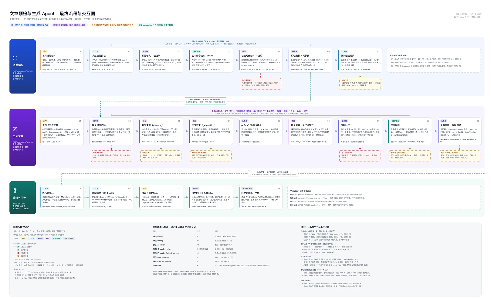

# 02｜AI 内容 Agent 的评测方法：先定义"什么算好文章"

> 系列：AI 应用笔记 · 02 ｜ 项目：源引 GEO（2026.07–2026.10，已阶段性中止）
> 面向：要做 AI 内容 / Agent 产品的产品经理与工程负责人
> 一句话：**评测先于自动化。** 如果没有先定义"什么算好文章"、没有失败样例和回归集，自动化只会更快地生产噪声；而"格式合规 100%"这种漂亮的指标，恰恰最容易让人误以为质量已经达标。

## 0. 先看结论

- **目标先改**：不做"生成文章的工具"，做"交付一份有材料依据、问题可追溯、可被验收的草稿"。
- **验收标准**：四项独立判定（功能状态 / UI 可用 / 文案易懂 / 内容可交付）；任何阻断项直接不通过；未知标"未验收"；不用平均分抵消硬失败。
- **内容质量**：六个维度（直接答题 / 事实归属 / 选择价值 / 信息增量 / 可读可摘录 / 品牌可信表达），每个维度都写"不能替代它的表面指标"。
- **失败样例比成功样例值钱**：软件与服务混淆、重复堆砌、检索负例、压缩丢条件——这些样例后来变成了回归集和门禁规则。
- **30 篇复测的结论**：结构合规 100%、首段直答启发式 100%，但篇幅整体偏长；收紧后简版进入目标带、标准版仍偏长。**格式类指标已经饱和，不能代表内容质量；质量判断最终还得靠人工盲评。**
- **边界**：单模型、单期实现、小样本、没有规模用户和付费；未验证 GEO 效果；盲审未系统执行；部分校准样例是我编写的示例，不是模型实测。

## 1. 背景：能生成，不等于能交付

内容 Agent 最容易做"虚"的地方，是它真的能生成看起来不错的文章。但在 ToB 内容场景里，"能生成"之后还有一段很长的交付缺口：

- 每篇文章都要人去找资料、核对品牌承诺和案例归属；
- 模型会把品牌简介、Logo、局部工期扩展成具体承诺；
- 发现问题后，人要重写全文，而不是改一两处；
- 纯文字交出去之后，还要人找图、选图、插图。

我的判断是：**用户要的不是"再生成一遍"，而是一份能直接进入编辑和发布的草稿。** 所以产品目标从"生成文章"改成"交付一份有依据、可验收、可继续编辑的草稿"——这一个目标变化，直接决定了后面的评测方式。

## 2. 评测对象：不是"模型输出"，是"用户能不能拿到可交付的结果"

这一点是我在写验收标准时定下的原则：

> 接口返回成功、自动化脚本跑通、单元测试全绿，都只是基础证据。验收对象是用户能否得到有用、可信、易理解且可继续操作的文章与界面。

因此验收拆成**四项独立判定**，任何一项有阻断问题，整体不通过：

| 判定项 | 检查什么 | 典型阻断问题 |
|---|---|---|
| 功能及状态正确 | 任务状态、资料注入、保存、同步是否正确 | 未保存却显示已保存；失败显示完成 |
| UI 可用 | 真实浏览器里能不能操作、看得清 | 关键内容不可读；操作不可达 |
| 文案易懂 | 提示、错误、状态是否说人话 | 内部术语；错误原因不明 |
| 内容可交付 | 答题、事实、选择价值、可读性 | 虚构事实；答非所问；资料越权 |

三条配套原则，缺一个标准就会失效：

1. **未知 ≠ 通过**：没检查的项必须标"未验收"，不能默认合格；
2. **不用平均分抵消关键问题**：虚构事实、答非所问、重要内容无法阅读、错误显示成功——任何一条出现，直接阻断，其他维度写得再好也不能抵消；
3. **固定条件才有可比性**：固定题目、固定资料范围、固定代码版本，记录每次运行；三次独立运行要报告全部结果，不能用一次偶然成功或无限重试来代表稳定性。

## 3. 方法一：把"什么算好文章"写成可判定的标准

在自动化之前，我先做的是"人工可判定"的质量标准。原因是：如果连人看两篇文章都说不清哪篇更好、为什么，就没法教模型，也没法做回归。

### 3.1 六个内容质量维度

| 维度 | 判定依据 | 不能替代它的表面指标 |
|---|---|---|
| 直接答题 | 保留原标题与条件，尽早给出核心答案 | 有标题、出现品牌名、正文很长 |
| 事实与归属 | 主体类型、品牌、地域、服务范围和必要条件正确 | 语气肯定、质量模型显示"完成" |
| 选择价值 | 说明有依据的差异，读者据此能比较或行动 | 每家都写"专业、全面、稳定" |
| 信息增量 | 正确利用资料，增加适用于本题的细节 | 引用了很多文件、堆了品牌关键词 |
| 可读与可摘录 | 层级清楚、比较信息容易找到，必要条件与主张相邻 | 有若干小标题、固定句长、强制表格 |
| 品牌可信表达 | 介绍具体、范围准确、候选同级、身份清楚 | 本品牌排第一、反复出现品牌名 |

这几条里，我最看重"事实与归属"和"选择价值"。前者决定文章会不会造成商业误导，后者决定文章对读者有没有用——而这两条恰好都是"看起来完成"最容易掩盖的。

### 3.2 "引用证据"到底要证到什么程度

内容 Agent 涉及资料，就绕不开"引用"这件事。我后来把引用拆成三层要求：

1. **来源可见**：来源名称、来源身份（手动/自动）、片段清楚；区分"召回候选"和"真正进入模型上下文的资料"——召回候选排名靠前，不代表它和本题相关；
2. **片段可核对**：片段对应原文与版本；资料一致只能说明"和这份材料一致"，**不能扩写成"现实已核实"**；
3. **缺证要标出来**：没有依据的具体主张标"待确认"，不能用模型常识冒充核实；需要时独立读取官方来源，不拿搜索摘要当正文依据。

这一层也是产品边界：AI 可以帮你找到依据、核对承诺、标出缺口，但不能替用户对所有事实背书。

## 4. 方法二：失败样例——回归集比"成功案例"更值钱

下面这些样例来自验收过程与用户反馈。它们在公开版里全部做了匿名化处理（题目、主体名、案例细节都不保留），只保留失败模式。

### 4.1 硬失败：把"软件"当成"服务主体"推荐

- **题目（已去掉地点与主体名）**："推荐几家提供某类服务的公司？"
- **观察**：生成稿把一款软件产品当作"提供该服务"的候选公司来介绍。
- **判定**：事实与归属不通过。软件工具的用途，不能直接推导为它本身承接人工服务；正确做法是删掉错误候选或换成确有依据的服务主体。加空行、改排序、加免责声明都不解决问题。
- **边界**：判断对象是"这条具体描述"，不是禁止文章提及软件。如果题目本身是比较软件，它可以是另一类任务里的候选。

### 4.2 阅读与选择价值问题：三家混着写、反复重复

- **观察**：首段同时介绍三家，随后在"先看业务匹配"重复介绍其中一家，在"另外两家可作比较"介绍其余两家，结尾又重复需求分流；"适合综合型需求/常规需求"没有给出具体差异。
- **判定**：可读性与选择价值存在问题。应先合并重复信息，把每家放在同层级条目里，围绕实际服务与适用需求展开；信息不足时不能用华丽措辞制造差异。
- **边界**：结构改善可以独立判断；三家公司的事实是否准确，不能只凭一段样稿判定。

### 4.3 检索负例：检索到材料 ≠ 选对材料

- **观察**：题目问"公司注销需要哪些材料"，准备阶段却把"股东变更材料"的片段（公司变更登记申请、股东变更协议、新股东资格证明等）注入了写作上下文——它和题目只共享"公司""材料"这类词。
- **判定**：这段材料没有直接回答当前问题，也没有被题目条件证明为必要背景，不应因为关键词重合就进入上下文。
- **正向控制**：真正相关的注销材料段落仍必须能被召回，不能为了排除股东变更资料，把所有材料清单都过滤掉。
- **结论**：评测检索不能只看"召回了没有"，还要看"注入得对不对"；同时必须保留正向控制，否则修一个 bug 会制造另一个。

### 4.4 压缩丢条件：最危险的一类失败

资料原文（已改写为通用示例）：资料齐备后 5 个工作日内提供处理反馈及初版结果，后续安排按实际期限另行通知。

| 候选句 | 判定 |
|---|---|
| "资料齐备后，在 5 个工作日内提供处理反馈和初版结果；后续安排按实际期限另行通知。" | 通过：保留了触发条件、交付对象和后续边界 |
| "每月 5 日前完成全部处理。" | 不通过：把资料提交的时间、处理时限、后续安排混成了新的交付承诺 |
| "5 个工作日内完成全部事项。" | 不通过：丢了"资料齐备"的前提，还扩大了交付对象 |

这类失败比"写得啰嗦"严重得多：它生成的是一个**新的商业承诺**。所以"少写一点"不能以删掉条件为代价，必要条件、推荐理由和事实依据都不能为了"达标字数"删除。

### 4.5 其他被固化成回归项的模式

- **没有合适的图就不配图**：政策类、非视觉题目强行配图，比无图更糟；配图位置和正文匹配度要单独检查。
- **不把示意图当案例或业绩证明**；图片要有图注、来源和使用范围。
- **"完成"标签不能当验收结论**：质量模型显示 completed，不代表内容可交付；验收必须独立看正文。

## 5. 决策：把评测放在自动化前面

**决策 1｜先做"人工可判定"，再做"机器可执行"**

- **背景**：Agent 链路长，最自然的冲动是先接自动化：自动质量检查、自动修订、自动配图、自动同步。但如果连"什么算合格"都没定义，自动化只会把不一致放大——同一篇稿子，系统说完成，人看一眼说不能用。
- **取舍**：A. 先把自动化跑通，靠人工在最后兜底；B. 先写验收标准与失败样例，人工能稳定判定后，再把可判定的部分做成门禁和回归。
- **结论**：选 B。验收标准先行 → 失败样例固化成回归集 → 能自动判定的规则进门禁（预检硬门禁、生成后质量复查、同步前 readiness 检查）→ 不能自动判定的保留人工盲评。**门禁的原则是"宁可少生成一篇，也不要产出一篇通不过校验的稿子"。**
- **代价**：前期没有"自动化"的故事可讲；验收标准要反复修订（每发现一种新失败模式就补一条）；人工盲评成本高、无法规模化。但换来的是：自动化有靶子，回归有依据，出问题能定位到"哪条标准没覆盖"。

> 图：预检与生成两条受控流水线，以及每步的任务预算。图中的秒数和调用次数是**任务上限**，不是实测平均；流程与预检/生成的责任分界见项目档案（geo-showcase）。图为已脱敏的项目内部流程图，不含客户与账号信息。

## 6. 方法三：30 篇复测——格式指标会饱和，质量不会

### 6.1 设计

在 2026-08 做过一轮篇幅档位复测：**三个篇幅档（简版/标准/深稿）各 10 篇，共 30 篇**，固定题目、固定结构样式（问答/清单/对比/案例/报告等）、固定模型与提示词版本。评估三件事：

- **结构合规**：是否包含该结构样式要求的段落与层级（目标 ≥ 90%）；
- **首段直答（启发式）**：开头是否直接回答原题、不写元叙述铺垫（目标 ≥ 80%）；
- **篇幅**：去空白字数是否落在目标带 ±15% 以内。

### 6.2 结果

| 档位 | 成功/计划 | 字数中位 | 目标带（±15%） | 结构合规 | 首段直答 |
|---|---|---|---|---|---|
| 简版 | 10/10 | 995 | 500–800（约 425–920） | 100% | 100% |
| 标准 | 10/10 | 1594 | 800–1200（约 680–1380） | 100% | 100% |
| 深稿 | 10/10 | 2251 | 1500–2200（仅观测） | 100% | 100% |

**结论**：结构合规和首段直答都 100% 达标；**篇幅整体偏长**——简版和标准版的中位数都超出了目标带（简版和标准版各偏长一档左右），深稿仅观测、中位略超上限；档位之间有区分度（简 < 标 < 深）。

### 6.3 收紧后的 15 篇复测

随后收紧提示词里的篇幅约束，又跑了 **5 篇/档、共 15 篇** 的复测：

| 档位 | 收紧后中位 | 变化 | 相对目标带 |
|---|---|---|---|
| 简版 | 880 | 下降约 115 | 刚进入带内（上限 920） |
| 标准 | 1523 | 下降约 70 | 仍偏长 |
| 深稿 | 2564 | 上升（样本小） | 仅观测 |

结构合规与首段直答仍然 100%。

### 6.4 这轮复测教给我的三件事

1. **格式类指标会饱和**：结构合规、首段直答这种"可规则化"的指标，在两轮里都是 100%——不是文章变好了，而是这两类指标已经被提示词和结构模板"喂熟"了。它们只能证伪，不能证明质量。
2. **篇幅是真实短板**：提示词收紧能改善简版，但标准版改不动，说明"篇幅控制"不是提示词一句话能解决的，涉及结构模板、资料注入量和模型行为。
3. **启发式 ≠ 人工判断**：首段直答是规则启发式（拒绝元叙述开场、限制首段长度），它和"人读完觉得这篇有用"是两件事。正式的盲评应该随机编号、隐藏生成方式、先独立看正文再看材料，这一套当时没有系统跑完。

## 7. 自动化该落在哪里：门禁、预算、人工在环

评测标准定下来之后，自动化才有明确的落点。我最终把"自动"限制在四件事上：

- **状态机**：任务从创建、执行、失败、重试到完成都有明确状态，可取消、可改稿、可重跑；
- **每步预算**：预检任务有墙钟上限和模型调用预算（图上为 240 秒 / 2 次），生成任务有共享调用上限（图上为 390 秒 / 8 次）；配图、质量复查也有各自的次数限制。预算是**任务上限**，不是平均耗时；
- **质量门禁**：预检有硬门禁（不通过不进入生成）；生成后有质量复查（不合格打回修补，有次数上限）；同步前有 readiness 检查；
- **人工在环**：用户可以在任意阶段打断、修改、重跑；所有中间结果留痕，任务可复现、成本可核算。

反过来说，我刻意没有做的事：不让 Agent 自己决定"什么时候算完成"；不用"自动通过"替代人工验收；不把多轮无限重试包装成稳定性；不承诺"全自动免审"。这些边界写在产品里，比写在 PR 里更有用。

## 8. 边界：这篇没做到什么

- **单模型、单期实现**：30 篇复测只用了当时的一个模型与一版提示词，不能代表模型能力上限；
- **小样本**：15 篇的收紧复测里，档位只有 5 篇，深稿中位数反而上升，样本不足以下结论；
- **没有规模用户、没有付费、没有营收**；项目在 2026.10 阶段性中止；
- **没有验证 GEO 效果**：文章质量与"发布后被 AI 引用"是两件独立的事，本文不对后者作任何声称；
- **盲审未系统化**：失败样例后来成了回归集，但"随机编号 + 隐藏组别 + 配对比较"的正式盲审没有完整跑完；
- **部分校准样例是我编写的示例**，不是模型生成结果——它们只能校准判据，不能当模型能力证据；
- **人工修订量没有统计**：没有可靠测量"平均每篇要改多少"，因此也不写"效率提升 X%"。

## 9. 结论来源拆分

**我的实践结论（来自源引 GEO 的验收、失败样例与复测）**：

- 四项独立判定、未知=未验收、平均分不能抵消阻断项；
- 六个内容质量维度及"表面指标"对照；
- 引用三层要求（来源可见 / 片段可核对 / 缺证标出）；
- 失败样例与回归集、正向控制的设计；
- "评测先于自动化"、门禁与预算的落点；
- 30 篇 / 15 篇复测的设计、数据与结论；
- "单例 ≠ 准确率"（个别任务上的修正成功只能说明机制有作用）。

**公开方法/资料（只做方法参考，未摘录原文）**：

- Agent 评测要"规则 + 模型 + 人工结合、看完整轨迹、关注多次运行的可靠性"——这是 Anthropic 公开的 Agent 评测文章给我的启发；
- RAG 评测要把"检索、依据一致性、答案相关性"分开评——参考 Microsoft 公开的 RAG 评测文档；
- 用真实任务做可用性测试、观察语言/布局/理解问题——参考 GOV.UK 的服务手册；
- 十项可用性启发（状态可见、用户语言、错误解释与恢复等）——参考 NN/g；
- "MVP 是原型、最大浪费是做了没人要的东西"——来自《启示录》的产品发现观点，本文只做转述。

以上方法我只取思路，判定表、样例和复测设计都是我在项目里自己写的。**没有搬运任何第三方报告、书籍原文或竞品材料。**

相关公开资料（仅方法参考）：[Anthropic：Agent 评测](https://www.anthropic.com/research/demystifying-evals-for-ai-agents)、[Microsoft：RAG 评测器](https://learn.microsoft.com/en-us/azure/foundry/concepts/evaluation-evaluators/rag-evaluators)、[GOV.UK：任务型可用性测试](https://www.gov.uk/service-manual/user-research/using-moderated-usability-testing)、[NN/g：十项可用性启发](https://www.nngroup.com/articles/ten-usability-heuristics/)。

## 10. 如果重来

1. **第 0 天就建 10 篇失败样例的回归集**，而不是等验收时再收集；
2. **把"人工盲评"设计成产品流程的一部分**：随机编号、隐藏生成方式、配对比较，先跑完 20 组再谈模型上限；
3. **篇幅控制从结构模板下手**，不指望提示词一句话解决；
4. **每个指标都配一个"它不能证明什么"的说明**——尤其是结构合规这种会饱和的指标。
