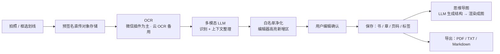

# 03｜从书页到知识库：OCR → 结构化 → 思维导图的流水线设计

> 系列：AI 应用笔记 · 03 ｜ 项目：阅记（Chinese Rose，2025.08–2026 上半年，上线小范围内测后主动止损）
> 面向：做 OCR / 多模态 / 知识管理类 AI 产品的产品经理与工程师
> 一句话：**OCR 的价值不在"识别得多准"，而在"识别之后能不能被结构化成可复用、可迁移的知识"。** 这条流水线里，每一个中间产物都要为下一步留下可验证的输入——否则用户拿到的只是一堆更整齐的碎片。

## 0. 先看结论

- **流水线**：拍照/框选 → 预签名直传对象存储 → OCR（微信插件为主、云 OCR 备用）→ 多模态 LLM 整理 → 白名单净化 → 编辑器高亮 → 保存（书/章/页/标签）→ 思维导图 → 导出/迁移。
- **章节定位靠三重信息**：书籍目录、拍照页边角的当前章信息、页码。只按拍照顺序堆叠，笔记就失去了"在书里的位置"。
- **划线句补全靠上下文**：参考前后划线句与周边内容（实现上取已有笔记前 2 段 + 后 1 段），把半句补成逻辑通顺的句子，去掉个人指向性表述，但不改变原意，并把新增部分高亮标记、允许用户撤销。
- **结构化先定模板**：金字塔原则（结论先行、以上统下、归类分组、逻辑递进）+ 编号知识点标题 + 一层结构；模型负责"填空"，不负责"发明结构"。
- **导出优先**：PDF / TXT / Markdown 先做，导入主流笔记工具是规划项。不锁定用户，是产品价值公式的要求，不是慈善。
- **边界**：上线小范围内测后主动止损（平台能力抹平差异化）；无商业化、无规模用户；OCR 准确率、导图合理性都没有做过系统评测；PRD 里的性能指标是目标，不是实测结果。

## 1. 背景：纸质书笔记的三个断点

读纸质书的人通常有两种笔记：划线（捕捉重点）和摘抄（二次加工）。但这两步之后往往没有第三步——笔记散落在纸上或相册里，没有结构、不能检索，复习时也找不到上下文。

我把问题拆成三个具体断点：

1. **录入成本高**：手抄划线句太慢，拍照后逐条整理更麻烦；
2. **结构缺失**：划线句是碎片，不知道属于哪一章、在书里的什么位置，复习时失去线索；
3. **无法迁移**：整理好的笔记留在某个 App 里，无法进入用户已有的笔记体系。

这三个断点决定了产品不是"OCR 工具"，而是一条**把书页变成结构化知识**的流水线。MVP 最终收敛到四个核心功能：书籍与笔记管理、拍照识别与整理、阅读与编辑导出、思维导图；原始需求列表里的其余 30 多条全部列为"后续"。

## 2. 流水线总览：每一段交付什么

每一段的产物和验收点：

| 阶段 | 产物 | 验收点 |
|---|---|---|
| 拍/选 | 图片（有张数上限） | 清晰、方向正确、能定位到书页 |
| 上传 | 对象存储里的临时文件 | 预签名直传成功、用户隔离、可清理 |
| OCR | 识别文本 | 只认划线区（划线模式）或全部正文（全文模式） |
| 整理 | 结构化 HTML | 只改新增内容、保留原文、补全但不改原意 |
| 编辑 | 用户确认后的笔记 | 高亮区可见、可修改、可撤销 |
| 保存 | 带位置信息的笔记 | 书/章/页正确，重开不丢 |
| 导图 | 结构化导图 + 图片 | 层级合理、可重生成、可导出 |
| 导出 | 文件 | 排版正确、格式规范、可迁移 |

## 3. 决策 1：OCR 主备策略——微信插件为主，云 OCR 备用

**决策 1｜用微信 OCR 插件做主方案，腾讯云 OCR 只做备用，不做完整智能路由**

- **背景**：微信小程序生态里做 OCR 有两条路——微信官方 OCR 插件（免费、本地、与小程序体验一体）和云厂商 OCR（按调用量计费、精度更高、后端可控）。MVP 阶段预算和体验都是硬约束，但精度又是产品命门。
- **取舍**：A. 云 OCR 为主——精度高、可调试，但每次识别都计费，MVP 成本不可控；B. 微信插件为主——零成本、隐私好、速度快，但精度上限低（选型时经验区间约 90–95%）、平台绑定、后端难监控；C. 混合智能路由——兼顾成本与精度，但架构复杂、维护成本高。
- **结论**：选 B + 备用。微信 OCR 作为 MVP 主方案；后端把 OCR 抽成统一接口（策略模式），保留腾讯云 OCR 实现作为降级方案——微信识别失败或质量不达标时切换。不做智能路由。
- **代价**：识别精度的天花板就是微信插件的水平；调试困难（识别发生在端上）；以后要换实现，得重新验证降级逻辑与用户提示。换来的是 MVP 阶段 OCR 调用成本为零，以及"先把主链路跑通"的时间。

## 4. 决策 2：把"识别 + 整理"交给多模态 LLM，而不是"OCR 全文 + 规则拼接"

**决策 2｜用多模态大模型端到端完成"看划线 + 整理成结构化笔记"，而不是先出全文再做规则加工**

- **背景**：传统做法是 OCR 出全文，再用规则/小模型做断句、去噪、拼段。问题是：划线区域本身就是视觉信息，"哪句话被划了"在纯文本里丢了；用户在书上划的经常是半句，规则拼不出通顺的表达。
- **取舍**：A. OCR 全文 + 规则整理——可控、便宜、可解释，但还原不了"划线意图"；B. 多模态 LLM 一步完成识别与整理——能理解划线、能补全上下文、能按结构输出，但不可控、有幻觉风险、成本更高。
- **结论**：选 B，但加三道保险：① 用免费的多模态模型先验证效果，再评估是否升级到付费模型；② 模型输出必须用标记包裹"新增内容"，**不允许修改已有笔记**；③ 编辑器把新增区高亮出来，用户可检查、可修改、可撤销。
- **代价**：模型可能"顺手"改写原文——这是产品必须用高亮和可撤销来兜底的；多模态调用的时延和成本高于纯 OCR；识别结果不再是一个可逐字比对的文本层，评测难度变大。

这里的关键不是"用不用大模型"，而是**把大模型的输出限制成可审计的增量**：新增内容是标记出来的、原文是锁住的、用户是最终确认者。

## 5. 决策 3：上下文只给"前 2 段 + 后 1 段"

**决策 3｜整理时的上下文窗口固定为已有笔记的前 2 段 + 后 1 段**

- **背景**：划线句要补全，必须知道它在说什么；但把整本书的笔记都塞给模型，成本、时延和噪声都会失控，历史上文里也可能有无关内容。
- **取舍**：A. 给整本书的已有笔记——上下文最全，但贵、慢、噪声大，而且随笔记增长不可持续；B. 只给当前页面图片——最省，但补全和编号延续会断；C. 固定窗口（前 2 段 + 后 1 段）——成本可控，能覆盖大部分"编号连续性/前后语义"场景。
- **结论**：选 C。这个窗口是产品决策，不是技术默认值——它定义了"模型能看到多少原文"，也定义了补全能做到什么程度。
- **代价**：跨章节、跨页的语义关联会丢；如果用户在中间插入新笔记，编号连续性可能断，需要靠规则重排和用户编辑兜底；窗口大小本身没有做过 A/B 实验，是经验值。

## 6. 结构化规则：把"识别"变成"笔记"的关键

### 6.1 章节定位：三重信息

一句划线句要放回正确的位置，至少需要三种信息：

1. **书籍目录**：章节标题，确定"这句话属于哪一章"；
2. **拍照页边角的当前章信息**：页面版式里的章名/页码信息，校验当前页属于哪一章；
3. **页码**：确定章内顺序与页内位置。

三者结合，才能把一句划线句放回正确的章节与顺序里，而不是简单地按拍照顺序堆叠。代价是：目录缺失、版式特殊（诗集、图文书、无页码）时定位会失败，这时只能让用户手动指定章节——人工兜底不是失败，是设计的一部分。

### 6.2 划线句补全：补全，但不改写

用户划的句子经常是半句，或者跳过中间内容，直接提取会得到语义断裂的碎片。我的处理规则是：

- **补全依据**：参考前后划线句或划线句周边的内容（实现上就是前 2 段 + 后 1 段的上下文）；
- **补全目标**：在不改变原意的前提下，把碎片整理成逻辑通顺、可独立阅读的句子；
- **去个人指向**：去掉"我/你"这类个人指向性表述，让句子变成可复用的知识而不是私人碎碎念；
- **不改原文**：补全只能发生在新增内容里，已有笔记一个字都不动；
- **可撤销**：新增部分高亮显示，用户确认后保存，不满意可以改。

这条规则的产品含义是：**补全是"最小必要改写"，不是"让 AI 重写一遍笔记"。** 一旦模型开始自由发挥，用户就不敢用它的结果。

### 6.3 金字塔结构化：结论先行、以上统下

整理后的笔记按金字塔原则组织：

- **结论先行**：先给结论/知识点标题，再展开细节；
- **以上统下**：下一层是上一层论点的支撑，不做平铺；
- **归类分组**：同主题的要点归到一个知识点标题下；
- **逻辑递进**：按"是什么 → 为什么 → 怎么做"或原文逻辑推进。

落到格式上就是几条硬约束：

- 大章节用二级标题（h2），**编号知识点标题**用三级标题（h3），次级要点用四级标题（h4）；
- 知识点细节用无序列表展开；有明确先后顺序的步骤用有序列表；嵌套最多 2 层；
- **只保留一层知识结构**，避免把笔记写成小作文；
- 新增编号从前文最大编号 +1 开始，保证连续性；
- 区分"延续"和"新知识点"：如果前文是列表、这次识别的是列表的补充项，就追加为列表项、不新建标题；如果前文是段落、这次是新话题，就拆成 3–8 个独立知识点、逐个建编号标题。

### 6.4 决策 4：模板由产品定，模型只负责填空

**决策 4｜结构化模板由产品定义，模型只负责"按模板填空"，不负责"自由组织"**

- **背景**：如果只给模型一句"整理成结构化笔记"，每次输出的结构都不一样：有的全用段落，有的全用列表，编号乱跳，用户每次都要重新适应。
- **取舍**：A. 让模型自由组织——可能更贴合内容，但结果不可预期、不可回归、不可维护；B. 固定模板 + 模型填空——一致性高、可预期、方便做 UI 和导出，但对特殊书型不友好。
- **结论**：选 B。产品定义标题层级、列表规则、编号连续性、"延续 vs 新知识点"的判断条件；模型在这个框架内做语义判断和内容整理。
- **代价**：模板会僵化——小说、诗集、图文书的笔记结构可能不适合"编号知识点 + 列表"；后续要靠更多结构样式（如"摘录型/问答型"）来覆盖，而不是一个模板打天下。

## 7. 思维导图：从结构化笔记到一张可复习的图

导图是阅记差异化的最后一个环节，也是"知识库"的可视化入口。

- **输入**：某本书下按时间排序的笔记（结构化后的 HTML / Markdown）；
- **生成**：把笔记交给大模型，按"主题 → 章节 → 知识点"的层级生成导图结构（MST / Markdown 大纲），再由渲染服务生成图片；
- **交互**：查看、缩放、一键重新生成、导出图片、保存到相册/分享；
- **触发**：用户主动点"生成导图"；笔记达到 5 条时提示生成；新增笔记后可更新。

这里的取舍是：**导图结构由模型生成，产品只保证"可重生成"和"可导出"，不追求"一次生成就完美"。** 因为知识结构的合理性非常主观，自动评测几乎不可行；与其做一个"看起来智能"的黑盒，不如把重生成权交给用户（节点编辑列为后续）。代价是：导图质量依赖笔记本身的结构化质量——如果前面的划线句补全和金字塔结构没做好，导图只是把碎片画成一棵树。

## 8. 导出与迁移：把"不锁定"写进产品

**决策 5｜导出优先于花哨功能：先支持 PDF / TXT / Markdown，并规划导入主流笔记工具**

- **背景**：用户已经有印象笔记、飞书、Notion 这类笔记体系。如果阅记不能把整理结果送回去，它就只是"又一个孤岛"，用户迁移成本极高。
- **取舍**：A. 做深自己的编辑/复习/社交功能，把用户留在产品里；B. 先做好导出，把自己定位成"加工步骤"而不是"终点"。
- **结论**：选 B。MVP 支持导出 PDF（打印/存档）、TXT（纯文本）、Markdown（二次编辑），导出流程是"选择格式 → 预览 → 确认"；导入主流笔记工具列为后续规划。
- **代价**：用户有了导出，就可能直接迁移走，留存变差；多格式的排版维护成本也不低。但这是用户价值公式决定的——**新体验 − 旧体验 − 替换成本 > 0，产品才成立**。降低替换成本，才有机会被真正用起来。

## 9. 知识库：MVP 做到哪、没做到哪

在这条流水线里，"知识库"不是一个独立模块，而是结构化笔记的最终形态：

| 层 | MVP 实际做到 | 没做到 |
|---|---|---|
| 书 | 书架聚合、按书看笔记、搜索/标签/阅读状态筛选 | 多设备同步、协作 |
| 章 | 章节定位、按章组织笔记 | 完整目录树自动重建 |
| 笔记 | 划线/框选识别、AI 整理、阅读/编辑双模式、重要度标记 | 语义检索、问答 |
| 导图 | 一键生成、查看、导出图片 | 节点编辑、专业格式导出（如 XMind） |
| 迁移 | PDF/TXT/Markdown 导出 | 一键导入主流笔记工具 |

**我没有把它做成 RAG 问答库**——MVP 阶段收敛到"拍照 → 识别 → 整理 → 导图"的最小闭环，语义检索与问答是明确的后续项。这个克制是有意的：一个人做产品，先把一个闭环做通，比同时铺五个方向更可能验证真实价值。

## 10. 边界：为什么这个项目停了

阅记完成上线与小范围内测后，我在复盘里选择了主动止损，原因很具体：

- 通用笔记工具已经能覆盖大部分能力：Notion 能做 OCR、智能整理和 AI 辅助；Manus 这类 Agent 产品可以把"识别 → 整理 → 导图"串起来；
- 笔记软件加 OCR 与思维导图并不难，我的差异化会被平台能力快速抹平；
- 用户替换成本很低——即使我把体验做得更好一点，用户也没有理由从已有工具迁移过来。

这意味着：继续投入只会变成"坚持"，而不是"验证"。

其他没做到的事：

- **没有系统评测 OCR 准确率**。PRD 里写的是目标（印刷体 >95%、单页 <3s），但项目没有做系统实测；我只有体验层面的判断，这一点必须诚实；
- **没有验证导图结构合理性**，只有"可重生成"这个兜底；
- **没有规模用户、没有商业化、没有营收**；
- 上下文窗口大小、补全规则都是经验值，没有做对照实验。

## 11. 结论来源拆分

**我的实践结论（来自阅记的设计与实现）**：

- 流水线分段与每段产物/验收点；
- OCR 主备策略（微信插件为主、云 OCR 备用、不做智能路由）；
- "识别 + 整理"交给多模态 LLM、但只允许审计增量；
- 上下文窗口 = 前 2 段 + 后 1 段；
- 章节定位三重信息、划线句补全规则、金字塔结构化与编号连续性规则；
- "模板由产品定、模型只填空"；
- 导出优先、不锁定用户的决策；
- 知识库的 MVP 边界与止损理由。

**公开方法/资料（只做方法转述，未摘录原文）**：

- 金字塔原理（结论先行、以上统下、归类分组、逻辑递进）——芭芭拉·明托的公开方法，本文借用的是它的结构原则，具体规则是我按产品需要改写的；
- "MVP 是原型，不是缩水版产品"——来自《启示录》的产品发现观点，我只做转述；
- OCR 服务选型时的精度区间（微信插件约 90–95%、云 OCR 约 95–98%）来自项目选型文档里记录的估计值，是选型参考，不是我的实测数据；
- 用户价值 = 新体验 − 旧体验 − 替换成本——俞军《产品方法论》中的公开公式，我用来解释"为什么必须做导出"。

## 12. 如果重来

1. **先做"一本书的闭环"再做"一类书"**：选一本版式最标准的书把定位和补全做到可用，而不是一开始兼容所有书型；
2. **把 OCR 准确率与补全质量做成可回放的小评测集**：哪怕只有 30 页，也比"感觉还行"可靠；
3. **导图先做"可编辑的大纲"再做图片**：大纲能改，图片只是导出；
4. **在立项前先验证"用户会不会迁移"**：先确认替换成本假设，再决定要不要投入做这条流水线。
