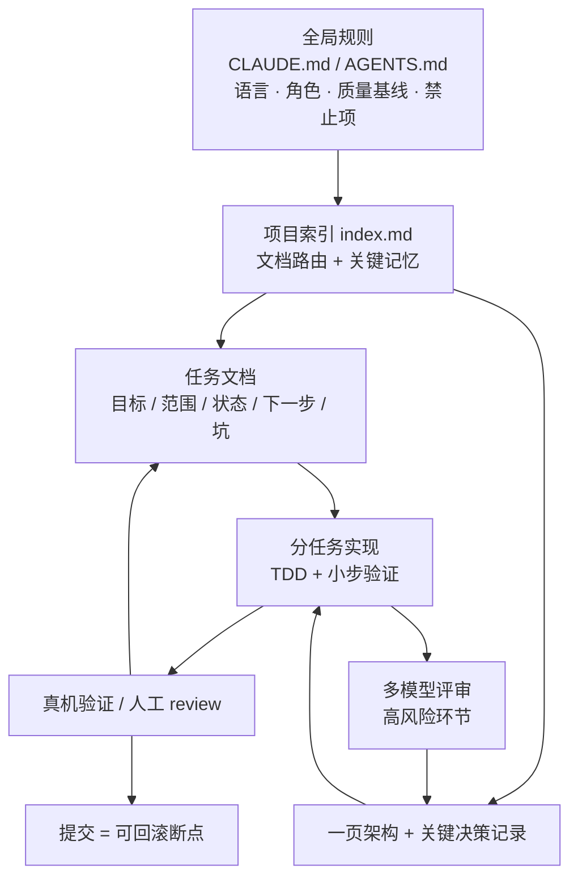

# 04｜个人 AI 协作工作流：一个人怎么用 AI 把产品做上线

> 系列：AI 应用笔记 · 04 ｜ 项目：源引 GEO / 阅记 / 颜配（三个 0→1 项目）
> 面向：想用 AI 放大个人产出的产品经理，以及关心"AI 协作到底怎么落地"的面试官
> 一句话：**AI 协作的瓶颈不在模型能力，而在上下文管理和验收标准。** 产品经理在这件事里的新角色，不是"写更长的 prompt"，而是设计一个让模型不跑偏、让人能验收的协作环境。

## 0. 先看结论

- **上下文用文件管理**：全局规则文件（`CLAUDE.md` / `AGENTS.md`）→ 项目索引（文档路由）→ 任务文档 → 代码/测试。稳定的事实进文件，临时的讨论留在会话。
- **流程固定**：简单需求 → PRD → 一页架构 → MVP 看板 → 分任务实现 → 真机验证。先出方向、再拆小任务，一次只做一个最小可验证闭环。
- **TDD 是最适合 AI 编程的默认工作流**：先把预期输入输出写成测试，让模型确认失败，再实现到通过，最后人工 review。测试是"结果契约"，能有效防止模型跑偏。
- **多模型评审**：高风险环节（架构、方案、代码）一个模型出结论、另一个模型以审视性视角挑战，最后人来取舍；评审意见要沉淀成决议，而不是聊完就丢。
- **上下文会腐败，会话要断点续传**：长会话里模型会遗忘约束、重复犯错、越来越自信地写错；让它先输出交接摘要，新会话从"交接 + 索引"开始。
- **边界**：AI 可以生成选项，但不替你承担判断。取舍、验收、用户沟通必须人来做；不要为了效率把密钥、客户数据、内部链接放进上下文。

## 1. 背景：一个人 + 三个项目

2025–2026 年，我用 AI 协作的方式独立完成了三个 0→1 产品：

- **阅记**（微信小程序 + Go 后端）：从 40+ 款竞品调研、PRD、一页架构、前后端实现到上线内测，产品与实现都是我一个人；
- **源引 GEO**（Next.js 全栈 + 大模型 + 浏览器扩展）：从产品定义、PRD、原型、前后端到上线免费内测，2026.10 阶段性中止；
- **颜配**（Flutter + Go）：完成 MVP，未正式上线。

一个人做产品的真实约束不是"写不完代码"，而是：**注意力是唯一稀缺资源**。如果每次都要重新给模型解释项目背景、每次都要人工检查它有没有跑偏，AI 带来的加速会被沟通成本和返工吃光。所以我后来把大部分精力花在流程上——不是为了规范，而是为了让自己不用反复救火。

## 2. 总览：上下文 + 流程 + 验收，三条腿



三条腿缺一不可：只有上下文没有流程，模型会做很多"看起来对"的东西；只有流程没有验收，流程会退化成打卡；只有验收没有上下文，模型每次都要从零理解项目。

## 3. 上下文管理：三层文件 + 一个索引

### 3.1 三层结构

| 层 | 放什么 | 为什么放这里 |
|---|---|---|
| 全局规则 | 语言与沟通约定、角色分工、代码质量基线、测试要求、禁止事项 | 每次会话都要遵守，不能靠临时提醒 |
| 项目索引 | 文档地图（PRD/架构/ADR/任务文档在哪）、关键记忆、当前状态入口 | 模型不用一层层翻代码就能定位实现方案 |
| 任务文档 | 目标、范围、验收、当前状态、下一步、"已否决方案"与坑 | 长任务跨会话时，这里是唯一的断点 |

再往下才是代码和测试。**顺序很重要**：模型先读规则和索引，再读任务，最后才看代码；反过来，它就会陷在实现细节里，问什么答什么，不知道项目要什么。

### 3.2 四条上下文原则

1. **稳定的事实进文件，临时的讨论留在会话**：项目背景、技术选型、接口约定写进文档；"这次先这样做"这种临时决定，要么立刻落文档，要么明确它只在本次会话有效。
2. **每发现一个问题就沉淀**：模型犯过的错（比如漏了某个边界、误用了某个接口）写进任务文档或规则文件，下一次它就不会再犯；只在聊天里说一次，等于没说过。
3. **项目边界要写清**：前后端两个仓库时，把各自路径、职责、接口契约写在索引里，别让模型猜。
4. **不要把一切都塞进上下文**：全量代码、全部文档、所有历史对话一起塞，成本和噪声都会失控，还会挤掉真正重要的约束。上下文不是越多越好，是越准越好。

**决策 1｜用文件系统管理上下文，而不是靠更长的 prompt**

- **背景**：早期我在单次对话里解释项目背景、贴代码、贴需求，一次能聊很久；但换个会话就要重来一遍，而且模型经常忘记几轮前的约束。
- **取舍**：A. 每次把更多内容贴进对话——即时满足，但不可复用、成本高；B. 把项目知识沉淀成文件，会话只做增量——前期要花时间维护，但可复用、可交接。
- **结论**：选 B。规则、索引、任务文档、架构图都进仓库；会话从"读索引"开始，而不是从"我跟你介绍一下这个项目"开始。
- **代价**：文档本身要花时间写和维护；文档过期比没有文档更危险（模型会照着过期的说明做），所以每次改架构必须同步改索引。这个成本是真实的，但它换来的是可复用。

## 4. 流程：先出方向，再拆小任务

我把开发流程固定成六步：

```text
简单需求 → PRD → 一页架构 → MVP 看板 → 分任务实现 → 真机验证 → 迭代
```

| 步骤 | 产物 | 这一步真正要解决的问题 |
|---|---|---|
| 简单需求 | 一页纸：背景、用户、核心场景、不做清单 | 先确认"做什么、不做什么" |
| PRD | 用户故事 + 验收标准 + 边界条件 + 指标 | 把"感觉"变成可验收的行为 |
| 一页架构 | 一张图 + 技术选型理由 | 先定边界与依赖，再写实现 |
| MVP 看板 | 里程碑、任务、状态、每日进度 | 让"做到哪了"一眼可见 |
| 分任务实现 | 每次一个可独立验证的小任务 | 避免一个大任务把模型带进泥潭 |
| 真机验证 | 真实设备/真实浏览器上的验收 | 代码跑通 ≠ 用户能用 |

**决策 2｜复杂任务先出"方向正确、屏蔽细节"的大方案，再拆成可独立验证的小任务**

- **背景**：一开始我习惯把需求、架构、实现细节写进同一个文档，让模型一次做完。结果是文档越写越长，模型边做边跑偏，最后还要人来收拾。
- **取舍**：A. 一次给全——沟通轮次少，但返工大、难定位问题；B. 先方向、再拆分——多花几轮对齐，但每一步可验证、出错能定位。
- **结论**：选 B。大需求先生成"方向正确、屏蔽实现细节"的方案；确认方向后再拆成一个个可以独立验证的小任务；每完成一个，就在主文档/看板里更新进度。
- **代价**：前期多花时间；拆分粒度靠经验（太小碎、太大又回到老问题）；任务之间的依赖关系要人维护。

## 5. TDD：用测试当"结果契约"

AI 编程最大的风险不是"写不出来"，而是"看起来写对了"。TDD 对我最大的价值不是测试覆盖率，而是**在动手之前先把"什么算做对了"写下来**。

我的步骤：

1. 先把预期输入输出、边界条件写成测试（产品经理也能写：给什么输入、应该得到什么结果、什么情况应该报错）；
2. 让模型确认测试失败（证明测试真的在测东西，不是摆设）；
3. 让模型实现到测试通过；
4. 人工 review 测试本身是否合理（防止"把测试改成能过"）；
5. 真机/真实浏览器验证。

**决策 3｜把 TDD 作为 AI 编程的默认工作流**

- **背景**：模型经常会"顺手"改掉不该改的逻辑，或者在没覆盖的地方自由发挥。口头约束（"不要改动其他模块"）经常失效。
- **取舍**：A. 先写实现，靠 review 兜底——快，但 review 成本高、遗漏多；B. 先写测试，用失败倒逼实现——前期慢，但问题在早期暴露，且回归有保障。
- **结论**：选 B，但分场景：接口、规则、数据处理、状态机这些"输入输出可定义"的部分默认 TDD；纯探索性的 UI/视觉稿还原用真机验证，不硬套 TDD。
- **代价**：探索阶段写测试会拖慢节奏；测试写得不合理时，会限制实现方式；AI 可能为了让测试通过而写"应试代码"——所以测试本身也要 review。

## 6. 多模型评审：把"审视性"外包给另一个模型

我在高风险环节会用两个模型交叉评审：

- **一个模型出方案**（架构、技术方案、PRD 结构、代码实现）；
- **另一个模型以审视性视角挑战**：找出隐藏假设、边界情况、失败模式、代价与替代方案；
- **最后人来取舍**，并把"接受/拒绝 + 理由"写回文档。

实际用下来，它最有效的场景不是"让模型互相夸"，而是**逼出方案的漏洞**：一个模型写出来的方案通常自洽，另一个模型从"你这个方案在什么情况下会失败"切进去，往往能发现真正的问题。这类评审记录我也会保留——它比最终方案更能说明当时的判断过程。

**决策 4｜高风险环节用多模型评审，而不是单模型"一把过"**

- **背景**：ToB 场景里，一个没被发现的边界问题上线后就是事故；而单模型对自己的方案天然倾向于"没问题"。
- **取舍**：A. 单模型——快、成本低、流程简单；B. 双模型评审——慢、有额外成本，但能暴露盲区。
- **结论**：选 B，但只用在架构、关键方案、复杂代码 review 这些高风险环节；日常小改动不评审。
- **代价**：评审轮次增加、时间变长；两个模型意见冲突时要人来判断，而不是"谁说得响听谁"；评审结论必须落文档，否则下次还会重复讨论。

## 7. 上下文腐败与断点续传

**症状**：一个会话连续做几个小时之后，模型会开始出现这些表现——

- 忘记前面定过的约束（命名、接口、边界）；
- 重复问已经回答过的问题；
- 输出越来越长、越来越"正确但没用"；
- 自信地写出与项目现状不符的代码。

这不是模型"变笨了"，是上下文太长、噪声太多、重要信息被稀释。我的处理办法是**主动结束会话，而不是硬撑**：

1. 在会话还清醒的时候，让它输出一份交接摘要：目标、当前状态、已完成、下一步、已否决的方案、踩过的坑、关键文件位置；
2. 把摘要写进任务文档（不是只留在聊天里）；
3. 开新会话，从"全局规则 + 索引 + 任务文档"开始，而不是从头复述；
4. 每个可交付的小步都提交一次，提交就是断点，出问题可以回滚。

**决策 5｜给会话设"上下文预算"，到点就交接**

- **背景**：我曾经在一个会话里连续做几个小时，前期质量很好，后期开始反复犯同样的错误，人工纠错的成本超过重新开一个会话。
- **取舍**：A. 一个会话做到底——省去交接成本，但后期质量不可控；B. 到点交接——要写交接文档，但新会话更清醒。
- **结论**：选 B。长任务拆成多个会话，交接文档是必须产物；连续几小时的会话，宁可主动结束。
- **代价**：交接要花时间，而且交接质量取决于摘要写得全不全；有些上下文（比如"我刚试过某个方案不行"）很难完整传递，只能靠文档和提交历史补。

## 8. 产品经理不能外包的部分

AI 把"产出"变便宜了，但下面这些事反而更重要了：

- **判断与取舍**：AI 可以给你三个方案、列出每个方案的代价，但选哪个、为什么选，必须是人来定；
- **验收标准**：什么算好、什么算失败，是人定义的；模型只会按你给的尺子量；
- **用户沟通与访谈**：用户不会因为对面是 AI 就多说真话；
- **风险承担**：上线事故、客户承诺、合规问题，签名的是人，不是模型；
- **安全边界**：密钥、账号、客户数据、内部链接不进上下文；需要 AI 看的资料先脱敏。

还有一个反直觉的观察：**AI 越强，产品经理越需要懂技术判断**。不是为了自己写代码，而是为了看出模型哪里在胡说、成本花在哪里、这个方案在工程上是否成立。

## 9. 结果与边界

**做成了什么**：

- 三个 0→1 项目都完成了可运行的产品/MVP：阅记上线内测、GEO 上线免费内测、颜配完成 MVP；
- 一个人覆盖了产品定义、PRD、架构、前后端实现、测试与上线；
- 沉淀了可复用的文件结构（规则/索引/任务文档/看板）与工作流（PRD → 一页架构 → 看板 → TDD 实现 → 真机验证）。

**没做到 / 需要如实说的**：

- **没有效率对照实验**：我没有跑"用 AI vs 不用 AI"的对照，所以不写"效率提升 X%"；只能说同样的产品由我一个人完成，在资源约束下跑通了；
- **多模型评审和 TDD 都增加前期成本**：它们不是免费的，适合高风险与长周期项目，不适合所有场景；
- **文档维护是真实负担**：文档过期会误导模型，必须跟着代码一起更新；
- **AI 生成代码需要人兜底**：逻辑正确性、安全、边界条件仍然要人工 review 和测试；
- **三个项目的结局不同**：一个已主动止损、一个阶段性中止、一个完成 MVP 未上线——AI 能加速"做出来"，但不能替代"验证值不值得做"。

## 10. 结论来源拆分

**我的实践结论（来自三个项目的实际使用）**：

- 三层上下文结构（全局规则 / 项目索引 / 任务文档）与四条原则；
- 六步流程、"先方向再拆小任务"、看板式状态管理；
- TDD 的分场景使用与"测试本身要 review"；
- 多模型评审的适用边界与"评审结论落文档"；
- 上下文腐败的症状、交接摘要与断点续传的做法；
- "产品判断不可外包"与安全边界。

**公开方法与工具（只做方法/工具引用，未搬运内容）**：

- TDD（测试驱动开发）是 Kent Beck 等人提出的公开工程实践，本文写的是我在 AI 协作场景下的用法；
- "规格驱动开发（SDD）""上下文工程（context engineering）"是行业内公开讨论的概念，我没有引用具体文章或报告，只借用了"先规格、后实现"和"管理上下文而非堆 prompt"的思路；
- 多模型评审 / LLM-as-judge 是公开的模型使用实践，本文的具体流程是我自己定的；
- 工具层面用到过 Claude Code、Codex 等 AI 编程工具与文档/Figma/浏览器类 MCP 插件，本文不评价具体产品，只写工作流。

## 11. 如果重来

1. **从第一个项目开始就写规则文件和索引**，而不是做到一半才补；
2. **把"交接摘要"做成模板**（目标/状态/下一步/已否决/坑），而不是每次自由发挥；
3. **给每个任务定"验收证据"**（截图、测试、真机录屏），让 AI 的产出有可核对的交付物；
4. **更早接受"AI 会犯错"这件事**：把 review 和测试当作流程的一部分，而不是出问题后的补救。
